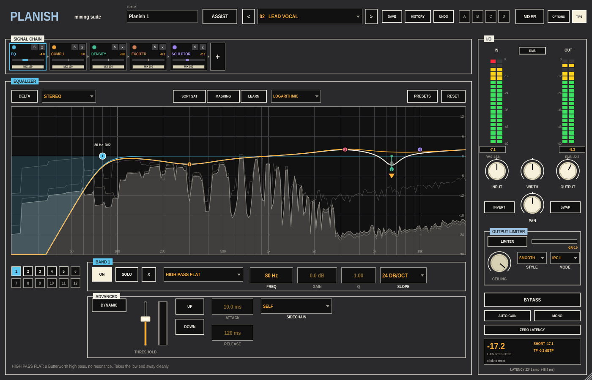

# Planish

A mixing suite for Ableton Live, built as one VST3. Planishing is the
hammering that smooths a piece of metal before it is burnished: Planish
is for the tracks of a mix, as [Burnish](https://github.com/taddeimania/burnish)
is for the master.

Eleven modules go in any order on a channel strip, each with its own power
switch, solo and wet/dry MIX: Gate, Equalizer (with dynamic bands and a
masking meter), two Compressors, Transient Shaper, Exciter, Sculptor,
Unmask, Density, Phase and Clipper. Around them: an I/O column with
metering, width, pan, an output limiter and gain-matched bypass; global
and per-module presets; a named undo history and four sets; a sidechain
input every module can listen to; and two assistants. ASSIST listens to a
track, works out what it is (a vocal, a kick, a bass, a pad...) and builds
a chain for it with a handful of intent controls. The VISUAL MIXER puts
every Planish in the set on one pad (level, pan, width) and its MIX
ASSISTANT sets a starting balance for the whole song.



The [guide](docs/Planish-Guide.pdf) (PDF) tours the panel, walks through a
first mix in Live and takes every module in turn.

## The panel

**Header**: TRACK (this instance's name, from Live's track name; double-click
to rename), ASSIST, PRESET (click for the list, `<` `>` to step, `*` means
changed), SAVE, HISTORY (every change by name: pick one to go back to it),
UNDO (also cmd-Z), sets A B C D (click to recall, shift-click to store),
MIXER, OPTIONS (spectrum display, averaging, peak hold, tilt, frequency
scale, alt-solo width, masking histogram, meters), TIPS.

**SIGNAL CHAIN**: one tile per module, in signal order. Click a tile to show
its panel, drag to reorder. On each tile: the power LED, S (solo), x
(remove), a difference meter (how much the module changes the level) and
the module's MIX (drag; double-click for 100%). `+` adds a module; the
Compressor can be added twice.

**Module panel**: every module has DELTA (hear only what it changes),
PRESETS (for that module) and RESET. Most have a channel mode: STEREO,
MID/SIDE or TRANSIENT/SUSTAIN, with an A and a B set of controls in the
latter two. The multiband modules split into up to three bands (LEARN puts
the crossovers at dips in what is playing), and the dynamics modules have a
sidechain choice per band: the module's own input, the full input, a band
of it, or the external sidechain (full or a band).

**I/O**: input and output meters (peak with RMS or short-term loudness),
INPUT, WIDTH, OUTPUT and PAN, INVERT and SWAP, the OUTPUT LIMITER (ceiling,
CLEAR / SMOOTH / THICK, IRC II / IRC LL / HARD / ZERO-L, gain reduction),
BYPASS, AUTO GAIN (the output turned to the input's loudness, so BYPASS is
a fair comparison), MONO, ZERO LATENCY, and the loudness readout (BS.1770).

## Modules

| Module | What it does |
|---|---|
| **Gate** | Up to three bands of gating and expansion, with separate open and close thresholds (hysteresis), ratio, attack, hold and release, a sidechain per band, and a scrolling trace with draggable thresholds. |
| **Equalizer** | Twelve bands, thirteen shapes (proportional Q, bell, band shelf; analog, vintage and Baxandall shelves; flat and resonant passes, 6 to 48 dB/oct). Any band can be DYNAMIC: UP or DOWN past a threshold, with attack, release and its own sidechain. SOFT SAT. Alt-click to solo a region. LEARN places nodes on the resonances it hears. The **masking meter** compares this track with another Planish in the set and shows where they collide; edit THIS EQ or the OTHER, with an INVERSE LINK that cuts one where the other boosts. |
| **Compressor 1, 2** | Up to three bands, PUNCH (with separate attack and sustain), MODERN or VINTAGE, RMS / PEAK / TRUE detection, ratios from 0.5:1 (upward) to 20:1, knee, adaptive release, makeup, AUTO GAIN, parallel mix per band, a detection filter, a sidechain per band, and a scrolling trace of in, out and sidechain. |
| **Transient Shaper** | Attack and sustain per band, with a contour for how quickly it acts; three envelope modes. |
| **Exciter** | Up to three bands of saturation with eight shapes (Retro, Tape, Tube, Warm, Overdrive, Scream, Clipper, Scratch) blended on an XY pad, drive and mix per band, TAME (soften the harsh top), pre-emphasis, tone, a post filter on the wet signal, and 4x oversampling. |
| **Sculptor** | Moves the spectrum toward a target for the instrument (sixteen of them, or one learnt from a reference) in 32 bands, with amount, tone and speed, inside a range you set. |
| **Unmask** | Ducks this track's bands only where the sidechain (another track) is present, with amount, sensitivity, attack and release: room for a vocal without a fixed cut. |
| **Density** | Slow upward and downward compression per band to even out a part, with threshold, range, ratio and speed and a 3 ms lookahead. |
| **Phase** | Rotates the phase of the track (0-360 degrees) and delays it by fractions of a sample, to line it up against the sidechain (a second mic on the same source). LEARN finds both. A scope shows the two. |
| **Clipper** | Up to three bands of oversampled soft-to-hard clipping with boost and threshold per band and set. |

## ASSIST

Press ASSIST, then GO and play the track. Planish listens (eight seconds
by default), decides what instrument it is, and builds a chain for it from
the modules and settings that suit that instrument, toward its tonal
target. The result page has a target list (instruments, plus references of
your own: `+ REFERENCE` learns one from an audio file), a tonal-balance
meter of the output against the target, and intent controls: EQ,
SCULPTOR, DENSITY, COMPRESSION, saturation (drive, tone and the XY shape)
and WIDTH. DETAILED VIEW goes to the modules it built; RESTORE puts back
what was there before.

## Visual Mixer and Mix Assistant

MIXER shows every Planish in the session as a node: left-right is pan,
up-down is output level, the handles are width; the node glows with the
track's level and turns red when it clips. The list beside it shows, hides
and renames tracks. SET, then A, B or C stores the whole mix; A, B or C
recalls it.

MIX ASSISTANT: set Live's faders to 0 dB, pick the tracks to include and
a FOCUS (the part that matters most), check each track's group (VOICE,
BASS, PERCUSSION or MUSICAL: guessed from ASSIST, the Sculptor target or
the track name), BEGIN LISTENING and play the song. GO TO RESULTS sets
each group's level against the focus; a fader per group moves it, BYPASS
ASSISTANT compares with how it was, ACCEPT keeps it.

## Presets and settings

Fifteen factory chains (lead and backing vocals, kick, snare, drum bus,
bass, guitars, piano, pad, dialogue, bus glue and two sidechain set-ups),
plus yours (SAVE). Module presets live under PRESETS in each module.
Everything is kept beside the settings file:

- macOS: `~/Library/Application Support/Planish/` (`Presets`, `Module Presets`, `Targets`)
- Windows: `%APPDATA%\Planish\`
- Linux: `~/.config/Planish/`

## Building

Needs CMake 3.22+ and a C++20 compiler (Xcode's clang on macOS). JUCE
8.0.9 is fetched on first configure (or pass `-DPLANISH_JUCE_DIR=...`).

```
cmake -B build -DCMAKE_BUILD_TYPE=Release
cmake --build build
ctest --test-dir build
```

On macOS and Linux the build copies `Planish.vst3` into the user VST3
folder (`~/Library/Audio/Plug-Ins/VST3` or `~/.vst3`). Pass
`-DPLANISH_COPY_PLUGIN=OFF` to skip that. `-DPLANISH_BUILD_TOOLS=ON` also
builds `PlanishSnapshot`, which renders the panel to a PNG without a host
(`PlanishSnapshot out.png stress` instead opens and closes the editor
repeatedly while audio runs, a check for crashes on close). The guide is
rebuilt with `Tools/make_guide.py` from those snapshots; see the top of
that file. VST3 only: no Audio Unit, so it will not load in Logic.

The engine (`Source/Engine`) has no JUCE dependency; `Tests/EngineTests.cpp`
checks the filters, oversampling, every module, latency alignment of the
whole chain, the mix, bypass, the limiter modes, zero latency and every
factory preset.

## Licence

AGPLv3. See LICENSE.
